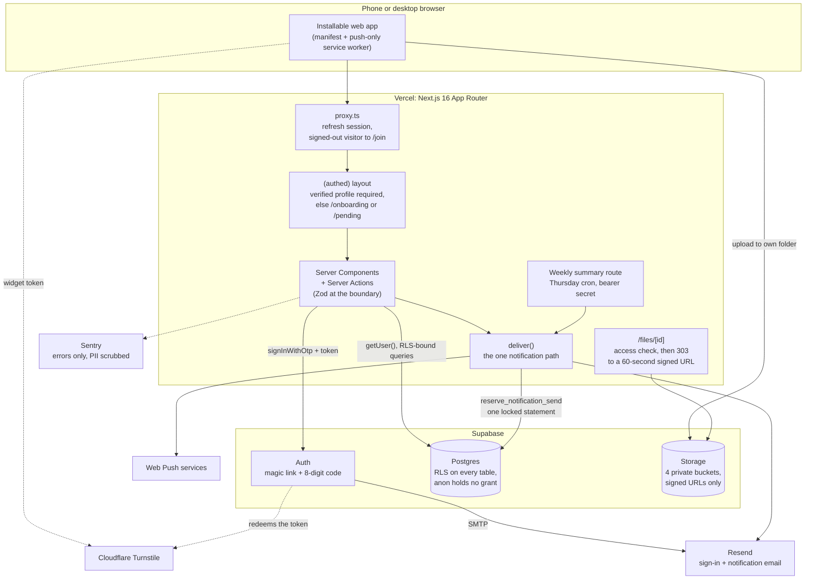

# On the Lees: A Private Network for Sommeliers

> Members-only, real-name network for sommeliers and wine professionals: a member directory, a forum, study groups with events, and Reconnect. Built on Next.js 16 and Supabase, with Postgres row-level security as the final gate on every read and every write.

---

**This repository documents the architecture and design decisions for On the Lees. The implementation is private, and so is the network: there is no public demo, no member data appears here, and every example is invented.**

[Architecture](docs/architecture.md) · [Decisions](docs/decisions.md)

---

## Status

**Live in production since June 2026, with real members.** The first commit landed on 2026-06-13 and the app was serving on its own domain two days later. It is small: the project's own records count 14 members on 2026-09-21 and 22 by 2026-09-24, with three moderators. It is a non-commercial goodwill project with one standing rule: no over-engineering and no feature additions.

## Problem

It began with a large group of wine professionals who had trained together and ended up scattered across private group chats, with no single private place to find each other, talk, or study together. The product it became is a network for sommeliers and wine professionals generally, and a public social network is the wrong shape for that. Findability is the point, so members use real names, but a real-name directory of working sommeliers must never be public or indexable.

The requirements that followed:

- **Private from day one.** Every member-facing page is behind sign-in, and the site is marked `noindex` at three layers.
- **Real names, gated by trust.** A new member gets in with an invite code that a member shares, which vouches them in, or by asking for access and waiting for a moderator to approve them.
- **A network, not a feature.** The directory, forum and study groups are the product. Reconnect (find a member whose contact details you lack) is one feature among them.
- **Phones first.** Every control is at least 44px tall on a phone, and the app installs to a home screen.

## Architecture

Three layers gate every request, and the database has the last word.

| Component | Function |
|-----------|----------|
| **`proxy.ts`** | Next 16's replacement for middleware. Refreshes the Supabase session and sends any signed-out request for a non-public route to `/join`. Public routes: `/`, `/join`, `/auth/*`, `/legal/*` |
| **`(authed)` layout** | Every member page lives under it. No profile goes to onboarding; an unverified profile goes to the review queue |
| **Row-level security** | Every public table has members-only policies for the `authenticated` role. `anon` is denied everywhere and holds no table grant |
| **SQL helpers** | `can_read_group` gates every group-scoped read; `visible_contacts()` masks each contact field per its owner's setting; helpers that answer about another member live in a schema the API does not expose |
| **Private Storage** | Four buckets, uploads only into the member's own folder, served by short-lived signed URLs. Photos lose their EXIF and GPS data on the device |
| **`deliver()`** | The single notification path: preferences, the suspended check, per-member send caps, and a signed one-click unsubscribe link |

## Tech Stack

| Technology | Role | Why This Choice |
|-----------|------|-----------------|
| Next.js 16 (App Router), React 19, TypeScript strict | Web app | Server Components by default; client code only for forms, uploads and filters |
| Tailwind v4 + shadcn (Base UI registry) | UI | "Editorial Utilitarian": dense directory and forum bones, warm editorial skin, Lora and Inter, one garnet accent |
| Supabase Postgres + RLS | Data and authorization | The database decides who reads and writes what, so a missed UI check cannot leak a row |
| Supabase Auth | Sign-in | Passwordless: an emailed link or an 8-digit code. Cloudflare Turnstile is verified inside Auth |
| Supabase Storage | Avatars, post photos, post files, resources | Private buckets, signed URLs, read policies that follow the post |
| Zod 4 | Validation | Input is validated on the server against schemas kept in one module |
| Resend | Email | Sign-in mail and eight notification emails |
| Web Push (VAPID) | Phone notifications | A service worker that handles push and notification clicks and nothing else: no cache, because phones get shared |
| Sentry | Error monitoring | Errors first, no session replay, PII scrubbed before send |
| Vercel | Hosting and the weekly cron | Manual production deploys from the CLI; rollback by promoting the previous deployment |
| Vitest + Playwright (Chromium and WebKit) | Tests | RLS proofs against a real local Postgres; end-to-end tests against a production build, the full suite on Chromium and twelve phone-critical surfaces again on iPhone WebKit |
| GitHub Actions | CI | Build, test and e2e jobs on every pull request; `main` is branch-protected |

## Technical Challenges & Solutions

### 1. Reads Were Scoped, Writes Were Not

**Challenge**: A read-only audit of the migrations found that the update policies authorized the row, never the column. A member could move a private group's thread into the open lobby, repoint a reply at another group's thread, or swap the parties on a connection to forge an accepted one and reveal a contact card. Storage released every object in the photo bucket to every member, because listing and signing a file both consult the same read policy.

**Solution**: Each gap was reproduced against a local stack before it was fixed, and each fix ships with an integration test that proves it. A `WITH CHECK` clause cannot stop a row leaving its group (a policy sees only the new row), so every column that names an owner, a parent or a scope is frozen by a trigger instead: authorship, membership records, a report's reporter and target, a reply's parent, and every primary key. Storage reads now follow the post that references the object.

### 2. The Invite Code Was an Unauthenticated Oracle

**Challenge**: The join action looked up an invite code, and wrote a binding for a valid one, before calling Supabase's sign-in, which is the only place the human-check token is verified. Anyone could guess codes at any rate with no token at all, and a hit left a binding that vouched them in after one sign-in and onboarding.

**Solution**: Order is the fix. The sign-in email is sent first, and the code is read only after Supabase accepts the request. The app deliberately never verifies the Turnstile token itself: the token is single use, and spending it in the app would make Auth reject every real sign-in. The signed-in door for typing a code later measured 878 guesses a minute from one account; it now allows five an hour, counted in a server-only table, and refuses when the counter cannot be read.

### 3. One Member Could Take the Front Door Down

**Challenge**: Sign-in mail and notification mail share one email quota of about 100 a day. Two legal loops (cancel a connection request and send it again; remove a member from a group and add them back) let one member mail the same person without limit. Spend the quota and nobody can sign in.

**Solution**: Caps per actor, in the one send path: 20 emails an hour and 40 a day, under half the quota, plus a 15-minute window for the same sender, recipient, type and subject. Push has its own, wider ration that ignores the subject, so a member cannot make another member's phone ring on command. The first version read the count and then wrote it, and bounded nothing: measured, ten parallel sends mailed eight times, and forty parallel reservations all passed a ceiling of twenty. The decision and the row are now one `security definer` statement under a per-actor advisory lock, and it fails closed.

## Key Decisions

| Date | Decision | Rationale |
|------|----------|-----------|
| 2026-06-14 | No over-engineering, no feature additions | A small, unproven goodwill project: ship the defined product properly and fix only real problems members hit |
| 2026-06-14 | Audit, then cut on purpose | A seven-dimension production audit fixed what members would feel and recorded what it cut: pagination, disposable-email blocking, a per-field privacy rewrite |
| 2026-06-16 | Reverse two of those cuts | With a real member on the app, a CI gate with branch protection and scrubbed Sentry monitoring were adopted |
| 2026-09-20 | Freeze ownership and scope columns by trigger | Policies authorize rows, not columns, and a policy cannot stop a row leaving its group |
| 2026-09-20 | Sign-in links by token hash, plus an 8-digit code | 11 of 19 failed sign-ins were links opened inside a mail app's browser, which the default link cannot survive |
| 2026-09-21 | The human check runs before anything about an invite | Order, not a second verification, closes the oracle |
| 2026-09-21 | Per-actor email caps in one locked statement | A global cap hands the flooder the outage; read-then-write loses the race |
| 2026-09-21 | End-to-end tests run against a production build | CI had been testing a dev server nobody deploys |
| 2026-09-23 | A small Markdown subset, no HTML, no library | The parser returns data and React builds every element, so there is nothing to sanitize |
| 2026-09-24 | Files on posts: PDF, TXT and CSV only, always downloaded | Nothing a member uploads is ever rendered by a browser as a page |

See [docs/decisions.md](docs/decisions.md) for every decision the project records, with its context and consequences.

## What I Learned

- **Write policies need the same scrutiny as read policies.** The audit's through-line was "reads were scoped, writes were not": a row could change the very column its read policy scopes on.
- **A limit that reads and then writes is not a limit.** Under parallel calls it lets nearly everything through. The check and the record have to be one locked statement.
- **A local stack is not evidence about production.** Production's `anon` role held full table grants on the 18 original tables for three months while every local and CI run showed none. RLS held, so nothing was readable; a migration revoked the grants, and the runbook now checks for them after every new table.
- **Test what you deploy.** The suite moved from the dev server to a production build, and on the way it surfaced two differences that only a production build shows: `Secure` cookies that WebKit will not send back over `http://localhost`, and a browser tab title carried from one sign-in door to the other by prefetch.
- **Scope is a decision with a date on it.** The launch audit cut Sentry and a CI gate. Two days later, with a real member using the app, both were adopted. Both the cut and the reversal are on record.
- **Measure, then change.** A tap-target guard went in after 229 of 463 controls measured under 44 by 44 pixels on an iPhone engine. The Markdown renderer was merged only after a plain post rendered pixel-identical to the old one on three engines.

## Results

- **Live since June 2026** with real members and three moderators
- **46 database migrations, 25 tables**, row-level security enabled on every one
- **707 Vitest tests and 118 Playwright tests** (one skipped by design) green on 2026-09-21, with 38 integration test files proving the RLS rules against a real local Postgres in CI
- **82 pull requests merged** to `main` from 2026-06-13 to 2026-09-25
- **Eight notification emails plus web push**, with per-type switches and a signed one-click unsubscribe on every email except the transactional access-approved one
- **Self-serve data export and account deletion**, with group ownership handed off and every stored file swept
- **An append-only moderator action log** that no client can write to
- **Copy rules enforced by a test** over the whole source tree: no em dashes, no AI-tell words, Title Case on headings, buttons and email subjects

## Project Status

| Area | Status | Description |
|------|--------|-------------|
| Directory, profiles, per-field contact privacy | Live | Real-name member index; each contact field masked in the database per the member's own setting |
| Reconnect | Live | "Looking for someone" posts, mutual opt-in connections, contact revealed only after acceptance |
| Forum and study groups | Live | Lobby plus a forum per group; public, private and hidden groups; events with RSVPs; shared resources |
| Trust and safety | Live | Invite and vouch, moderator review queue, report, block, suspend, action log |
| Human check, error monitoring, inbound mail | Live | Turnstile enforced on join; Sentry live since 2026-09-20 |
| Notifications | Live | Email and push with per-type switches; push keys set in production 2026-09-20 |
| Weekly summary email | Built | Scheduled for Thursdays; as of 2026-09-23 the route refuses every run until its secret is set |
| Photos and files on posts, Markdown subset, long-post folding, forum index layout | Merged | Merged to `main` on 2026-09-24 and 2026-09-25; the repository does not record their production deploy |

---

**Built by [James Shehan](https://jamesshehan.dev)**
