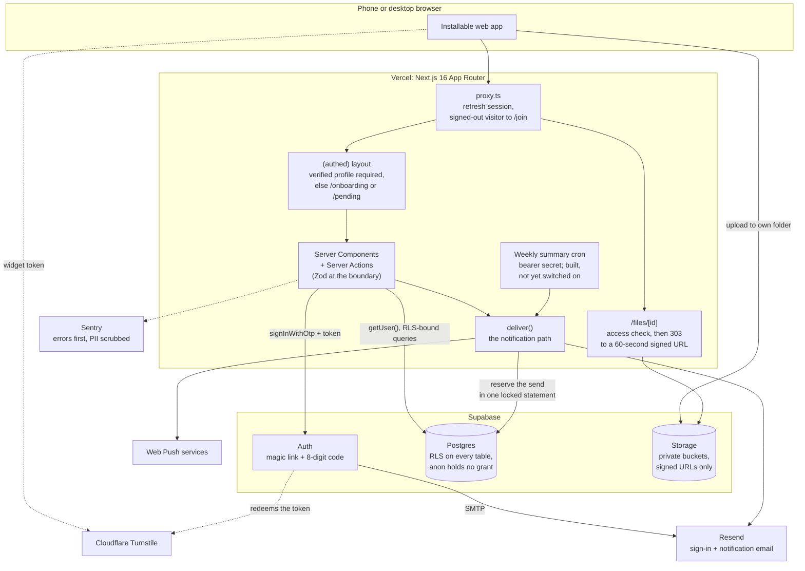

# On the Lees: A Private Network for Sommeliers

> A members-only, real-name network for sommeliers and wine professionals that I designed, built and run: a member directory, a forum, study groups with events, and Reconnect, for finding someone you met but never swapped contact details with. Live with real members since June 2026. Built on Next.js 16 and Supabase, with Postgres row-level security as the final gate on every read and write a member's session makes.

---

**This repository documents the architecture and design decisions for On the Lees. The implementation is private, and so is the network: there is no public demo and no member data appears here.**

[Architecture](docs/architecture.md) · [Decisions](docs/decisions.md)

---

## Problem

It began with wine professionals who had trained together and ended up scattered across group chats, with no single members-only place to find each other, talk, or study. Members need to be able to find each other, so they use real names, but a real-name directory of working sommeliers must never be public or indexable.

The requirements that followed:

- **Private from day one.** Every member-facing page is behind sign-in, and `noindex` is set three ways: in the page metadata, in `robots.ts`, and in a response header.
- **Real names, gated by trust.** A new member gets in with an invite code a member shares, or by asking for access and waiting for a moderator's approval. Either path records a vouch, and a vouch is what verifies a member.
- **A network, not a feature.** The directory, forum and study groups are the product; Reconnect is one feature.
- **Phones first.** Every control a thumb has to hit is at least 44 by 44 pixels on a phone, checked by a test on the iPhone engine, and the app installs to a home screen.

## Architecture

Three checks gate every request: `proxy.ts`, the `(authed)` layout, and Postgres row-level security. The database check is the one that cannot be skipped.

| Component | Function |
|-----------|----------|
| **`proxy.ts`** | Next 16's replacement for middleware. Refreshes the Supabase session and sends any signed-out request for a non-public route to `/join`. Public routes: `/`, `/join`, `/auth/*`, `/legal/*`, the install page, the web manifest, the push service worker, the unsubscribe link, and the weekly cron route, which checks its own bearer secret |
| **`(authed)` layout** | A signed-in visitor with no profile goes to onboarding, and one not yet verified waits on `/pending` |
| **Row-level security** | RLS is on for every table in the `public` schema. Member-facing tables carry members-only policies for the `authenticated` role; three server-only tables carry no policy and no grant. `anon` is denied everywhere and holds no table grant |
| **Private Storage** | Private buckets, own-folder uploads, short-lived signed URLs, read policies that follow the post; photos are re-encoded on the device, so their EXIF metadata, GPS location included, never leaves it |
| **`deliver()`** | The path for every notification except the transactional access-approved email: the suspended check, preferences, per-member send limits, and a signed one-click unsubscribe link |

## Tech Stack

| Technology | Role | Why This Choice |
|-----------|------|-----------------|
| Next.js 16 (App Router), React 19, TypeScript strict, Zod 4 | Web app | Server Components by default; client code only for forms, uploads and filters |
| Supabase Postgres + RLS | Data and authorization | The database decides who reads and writes what, so a missed UI check cannot leak a row |
| Supabase Auth | Sign-in | Passwordless link or 8-digit code; Turnstile verified inside Auth |
| Resend + Web Push (VAPID) | Email and phone notifications | The service worker handles push only, with no cache, because phones get shared |
| Sentry | Error monitoring | No session replay, PII scrubbed before send |
| Vercel | Hosting and scheduled jobs | Manual production deploys; rollback by promoting the previous deployment |
| Vitest + Playwright (Chromium and WebKit) | Tests | RLS proofs against a real local Postgres; end-to-end tests against a production build |

## Technical Challenges & Solutions

### 1. A Policy Authorizes the Row, Not the Column

**Challenge**: A Postgres UPDATE policy decides whether a member may edit a row, not which of its columns they may change, and its `WITH CHECK` sees only the new row. On its own, a policy cannot stop an edit that moves a row out of its group or changes who it belongs to.

**Solution**: A read-only audit of the migrations checked every write path for this, and each finding was reproduced on a local stack before it was fixed. A trigger now freezes every column that names an owner, a parent or a scope, and an integration test that signs in as different members pins each case.

### 2. The Human Check Comes Before the Invite Code

**Challenge**: The single-use Turnstile token is verified in one place only, inside Supabase Auth's sign-in call; verifying it in the app as well would spend it first, and Auth would then reject every real sign-in. Anything the join action does before that call runs without a human check, and the join action used to read the invite code there.

**Solution**: The join action now sends the sign-in email first and reads the invite code only after Supabase accepts. A failed send looks up and writes nothing, and the answer is identical for a valid code, an invalid one and none. Applying a code after sign-in is limited per account by the hour, counted in a server-only table before any code is read, and it fails closed.

### 3. Mail Limits That Hold Under a Parallel Burst

**Challenge**: Several member actions email another member, and some can be repeated on demand, such as cancelling and re-sending a connection request. A network-wide cap would stop one member's flood by silencing everyone else.

**Solution**: Per-member hourly and daily limits in `deliver()`, plus a short spacing rule for the same sender, recipient and subject. A first version that read the count and then wrote it let a parallel burst through, so the decision and the record are now one statement under a per-member advisory lock: one member's sends queue behind each other, and nobody else waits.

## Key Decisions

| Date | Decision | Rationale |
|------|----------|-----------|
| 2026-06-14 | No over-engineering, no feature additions | Ship the defined product properly, and change it only for problems members actually hit |
| 2026-06-16 | Adopt two items the launch audit had cut: a CI gate and error monitoring | Once the app was live, I wanted it diagnosable and safe to change; Sentry was wired then and has reported from production since 2026-09-20 |
| 2026-09-20 | Freeze ownership and scope columns by trigger | A policy authorizes the row, not the column, so it cannot stop a row leaving its group |
| 2026-09-20 | Sign-in links by token hash, plus an 8-digit code | The default link works only in the browser that asked for it, and a phone opens it inside the mail app's own browser, so links tapped within seconds still failed |
| 2026-09-21 | The human check runs before anything about an invite | Changing the order needs no second verification, which would spend the single-use token |
| 2026-09-21 | Per-member email limits, decided in one locked statement | A network-wide cap punishes everyone for one member's flood, and a limit that reads and then writes loses the race |

[docs/decisions.md](docs/decisions.md) gives each one's context and consequences.

## What I Learned

- **Write policies need the same scrutiny as read policies.** A row could change the very column its read policy scopes on.
- **The check and the record have to be one statement.** A limit that counts in one query and records in the next lets a parallel burst through before either commits.
- **A local stack is not evidence about production.** Default privileges and auth rate limits differ between the two, so grants are now stated explicitly in a migration rather than trusted to defaults, and production's own configuration is read before a number about it is quoted.
- **A phone opens a sign-in link in the mail app's own browser.** The default magic link only works in the browser that asked for it, so sign-in now uses a token-hash link that needs no cookie, plus an 8-digit code that works anywhere.

## Results

Measured at the head of `main` (2026-09-25) unless a line says otherwise:

- **Live since June 2026** with real members and member moderators
- **46 database migrations; 25 tables, each with row-level security enabled**
- **38 integration, 74 unit and 28 end-to-end test files**; the integration tests sign in as different members against a real Supabase to check the RLS rules, locally and in CI
- **The last full local run on record, 2026-09-21:** 707 Vitest and 118 Playwright tests passed, with one skipped by design
- **82 pull requests merged** to `main`
- **Eight notification email types plus web push**, each type with its own switch
- **Self-serve data export and account deletion**, with group ownership handed off and every stored file swept

## Project Status

| Area | Status | Description |
|------|--------|-------------|
| Production | Live | First commit 2026-06-13; serving on its own domain since 2026-06-15 |
| Directory, Reconnect, forum and study groups | Live | Per-field contact privacy enforced in the database; mutual opt-in connections; public, private and hidden groups with events |
| Trust and safety | Live | Invite and vouch, moderator review queue, report, block, suspend, action log |
| Human check, error monitoring, notifications | Live | Turnstile enforced on join; Sentry and web push live in production since 2026-09-20 |
| Weekly summary email | Built | Not yet switched on in production as of 2026-09-23: its cron route refuses every run until its secret is set |
| Photos and files on posts, Markdown subset, long-post folding, forum index layout | Merged | Merged to `main` on 2026-09-24 and 2026-09-25; the repository does not record their production deploy |

---

**Built by [James Shehan](https://jamesshehan.dev)**
