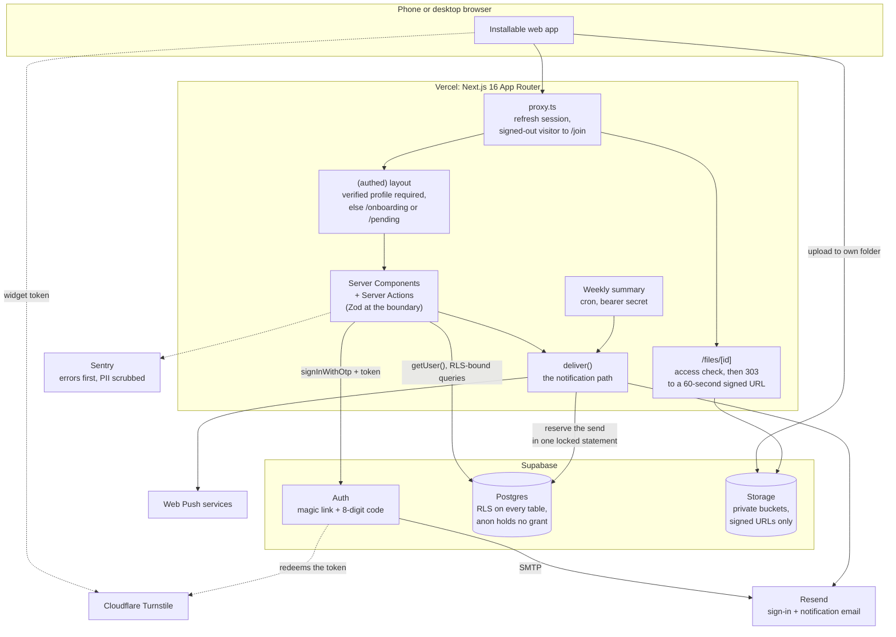

# On the Lees: A Private Network for Sommeliers

> A personal project: a members-only, real-name network I built and run for sommeliers and wine professionals, with a member directory, a forum, study groups with events, and Reconnect. Live with real members since June 2026. Built on Next.js 16 and Supabase, with Postgres row-level security as the final gate on every read and write a member's session makes.

---

**This repository documents the architecture and design decisions for On the Lees. The implementation is private, and so is the network: there is no public demo and no member data appears here.**

[Architecture](docs/architecture.md) · [Decisions](docs/decisions.md)

---

## Problem

It began with wine professionals who had trained together and ended up scattered across private group chats, with no private place to find each other, talk, or study. Findability is the point, so members use real names, but a real-name directory of working sommeliers must never be public or indexable.

The requirements that followed:

- **Private from day one.** Every member-facing page is behind sign-in, and the site is marked `noindex` at three layers.
- **Real names, gated by trust.** A new member gets in with an invite code a member shares, or by asking for access and waiting for a moderator's approval.
- **A network, not a feature.** The directory, forum and study groups are the product; Reconnect (find a member whose contact details you lack) is one feature.
- **Phones first.** Every control a thumb has to hit is at least 44 by 44 pixels on a phone, checked by a test on the iPhone engine, and the app installs to a home screen.

## Architecture

Three layers gate every request, and the database has the last word.

| Component | Function |
|-----------|----------|
| **`proxy.ts`** | Next 16's replacement for middleware. Refreshes the Supabase session and sends any signed-out request for a non-public route to `/join`. Public routes: `/`, `/join`, `/auth/*`, `/legal/*`, the install page, the web manifest, the push service worker, the unsubscribe link, and the weekly cron route, which checks its own bearer secret |
| **Row-level security** | RLS is on for every public table. Member-facing tables carry members-only policies for the `authenticated` role; three server-only tables carry no policy and no grant. `anon` is denied everywhere and holds no table grant |
| **Private Storage** | Private buckets, own-folder uploads, short-lived signed URLs, read policies that follow the post; photos lose EXIF and GPS data on the device |
| **`deliver()`** | The path for every notification except the transactional access-approved email: the suspended check, preferences, per-member send caps, and a signed one-click unsubscribe link |

## Tech Stack

| Technology | Role | Why This Choice |
|-----------|------|-----------------|
| Next.js 16 (App Router), React 19, TypeScript strict, Zod 4 | Web app | Server Components by default; client code only for forms, uploads and filters |
| Supabase Postgres + RLS | Data and authorization | The database decides who reads and writes what, so a missed UI check cannot leak a row |
| Supabase Auth | Sign-in | Passwordless link or 8-digit code; Turnstile verified inside Auth |
| Resend + Web Push (VAPID) | Email and phone notifications | The service worker handles push only, with no cache, because phones get shared |
| Sentry | Error monitoring | No session replay, PII scrubbed before send |
| Vercel | Hosting and the weekly cron | Manual production deploys; rollback by promoting the previous deployment |
| Vitest + Playwright (Chromium and WebKit) | Tests | RLS proofs against a real local Postgres; end-to-end tests against a production build |

## Technical Challenges & Solutions

### 1. Reads Were Scoped, Writes Were Not

**Challenge**: An audit of the migrations found that update policies authorized the row, never the column. A member could move a private group's thread into the open lobby, or swap a connection's parties to forge an accepted one and reveal a contact card.

**Solution**: Each gap was reproduced locally, fixed, and pinned by an integration test. A `WITH CHECK` sees only the new row and cannot stop a row leaving its group, so a trigger freezes every column that names an owner, a parent or a scope.

### 2. The Invite Code Was an Unauthenticated Oracle

**Challenge**: The join action read and bound an invite code before calling Supabase's sign-in, the only place the human-check token is verified. Anyone could guess codes at any rate, and a hit was vouched in after sign-in and onboarding.

**Solution**: Order is the fix: the sign-in email goes first, and the code is read only after Supabase accepts. The signed-in door for applying a code is now limited per account by the hour, counted before any code is read, and it fails closed.

### 3. One Member Could Take the Front Door Down

**Challenge**: Sign-in and notification mail share one daily sending quota. Two legal loops let one member mail the same person without limit, and once the quota is spent nobody can sign in.

**Solution**: Per-actor hourly and daily caps in `deliver()`, set so one member can use under half the daily quota. A first version that read the count and then wrote it let every reservation in a parallel burst past the hourly ceiling; the decision and the row are now one statement under a per-actor advisory lock.

## Key Decisions

| Date | Decision | Rationale |
|------|----------|-----------|
| 2026-06-14 | No over-engineering, no feature additions | A small, unproven, non-commercial project: ship the defined product and fix only real problems members hit |
| 2026-06-16 | Reverse two launch-audit cuts | With a real member on the app, a CI gate with branch protection and scrubbed Sentry monitoring were adopted |
| 2026-09-20 | Freeze ownership and scope columns by trigger | Policies authorize rows, not columns, and a policy cannot stop a row leaving its group |
| 2026-09-20 | Sign-in links by token hash, plus an 8-digit code | The default link works only in the browser that asked for it, and a phone opens it inside the mail app's own browser, so links tapped within seconds still failed |
| 2026-09-21 | The human check runs before anything about an invite | Order, not a second verification, closes the oracle |
| 2026-09-21 | Per-actor email caps in one locked statement | A global cap hands the flooder the outage; read-then-write loses the race |

[docs/decisions.md](docs/decisions.md) gives each one's context and consequences.

## What I Learned

- **Write policies need the same scrutiny as read policies.** A row could change the very column its read policy scopes on.
- **A limit that reads and then writes is not a limit.** The check and the record have to be one locked statement.
- **A local stack is not evidence about production.** Default privileges and auth rate limits differ between the two, so grants are now stated explicitly in a migration rather than trusted to defaults, and production's own configuration is read before a number about it is quoted.
- **Scope is a decision with a date on it.** The launch audit cut Sentry and a CI gate. Two days later, with a real member using the app, both were adopted. Both the cut and the reversal are on record, with the reasons.

## Results

- **Live since June 2026** with real members, moderated by members
- **46 database migrations, 25 tables**, row-level security enabled on every one
- **707 Vitest tests and 118 Playwright tests** (one skipped by design) green locally on 2026-09-21, with 38 integration test files proving the RLS rules against a real local Postgres in CI
- **82 pull requests merged** to `main` by 2026-09-25
- **Eight notification emails plus web push**, with per-type switches
- **Self-serve data export and account deletion**, with group ownership handed off and every stored file swept

## Project Status

| Area | Status | Description |
|------|--------|-------------|
| Production | Live | Serving on its own domain since 2026-06-15, two days after the first commit |
| Directory, Reconnect, forum and study groups | Live | Per-field contact privacy enforced in the database; mutual opt-in connections; public, private and hidden groups with events |
| Trust and safety | Live | Invite and vouch, moderator review queue, report, block, suspend, action log |
| Human check, error monitoring, notifications | Live | Turnstile enforced on join; Sentry and web push live in production since 2026-09-20 |
| Weekly summary email | Built | Not yet switched on in production as of 2026-09-23 |
| Photos and files on posts, Markdown subset, long-post folding, forum index layout | Merged | Merged to `main` on 2026-09-24 and 2026-09-25 |

---

**Built by [James Shehan](https://jamesshehan.dev)**
