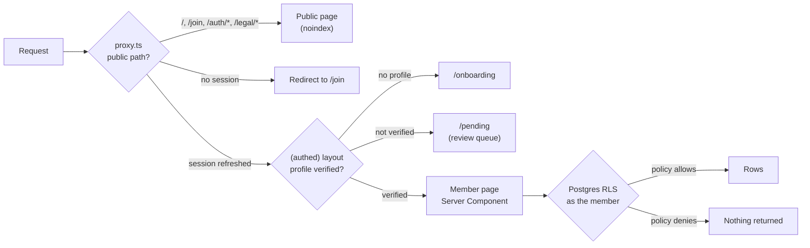
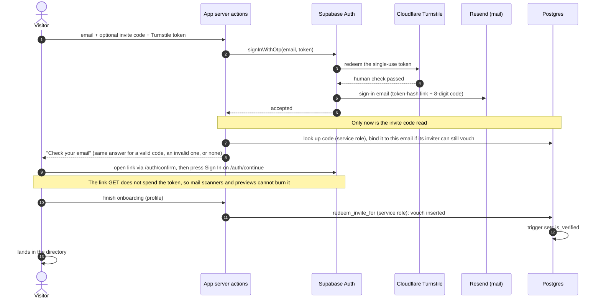
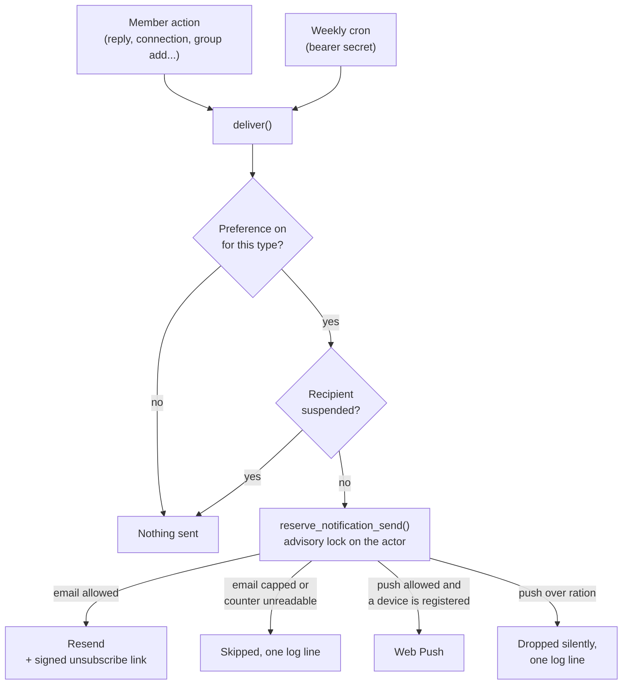
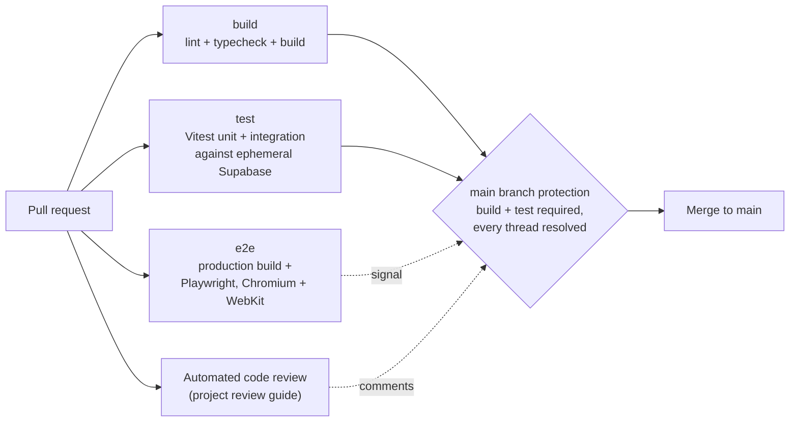

# Architecture: On the Lees

This page goes one level below the [README](../README.md): how a request is gated, how a stranger becomes a verified member, what the data model looks like, how the database enforces who may read and write what, how files and notifications work, and how the whole thing is tested and operated. Every name below (tables, functions, routes) is from the private repository; no member data appears here.

---

## 1. Three Gates on Every Request

A page is only as private as its weakest layer, so On the Lees checks access three times, and the database check is the one that cannot be skipped.

| Layer | Where | What it decides |
|-------|-------|-----------------|
| Proxy | `src/proxy.ts` (Next 16 renamed `middleware` to `proxy`) | Refreshes the Supabase session cookie; any non-public route without a session goes to `/join` with the original path carried in `next` |
| Layout | `src/app/(authed)/layout.tsx` | A signed-in user with no profile goes to onboarding; a profile that is not verified goes to `/pending`. Every member feature lives under this layout |
| Database | Row-level security on every public table | Members-only policies for the `authenticated` role. `anon` is denied everywhere and holds no table privilege. Server code reads identity with `getUser()`, never `getSession()` |

The UI checks exist for a good experience. The database check exists because a UI check can be forgotten, and the project rule is that RLS is the final backstop and is never weakened.

**Never indexable.** A private real-name network must not show up in search. `noindex` is set in three places: the root metadata (every page inherits it), `robots.ts` (disallow every crawler), and an `X-Robots-Tag` response header that also covers non-HTML responses. The same header block denies framing, stops MIME sniffing, and keeps internal paths out of cross-origin referrers.

---

## 2. Joining: From Stranger to Verified Member

There are no passwords. A visitor asks for access with an email address and, optionally, an invite code. The order of operations is the security property: nothing about the invite is read until Supabase Auth has accepted the human check.

| Path | How a person gets verified |
|------|----------------------------|
| Invite code at the request door | A bound code is redeemed at the end of onboarding; the vouch trigger verifies them |
| No code | They wait on `/pending`; a moderator's approval is a vouch, so it verifies them the same way |
| A code obtained later | `/pending`, Apply Code: five tries an hour per account, counted in a server-only table before any code is read |

Details that matter:

- **Members share codes; they do not mint them.** Only a moderator or the service role can create an invite, every invite must carry a use cap and an expiry, and a member reads no invite rows at all. The Invite page calls `active_invite()`, which returns the newest live code marked as shared. A code minted for one named guest is never broadcast.
- **Vouching is a moderator action.** An ordinary member cannot insert a vouch; the invite path runs as the service role and is the only non-moderator route to verification.
- **The app never calls Cloudflare's verification endpoint.** The Turnstile token is single use and Supabase Auth holds the secret. Verifying it in the app would spend it, and Auth would then reject every real sign-in.
- **Links survive the mail app's browser.** The templates link by token hash rather than the default browser-bound link, and every email carries an 8-digit code as a fallback. The code length stays at 8: anyone can request a code for any address, so shortening it to 6 would divide the work of guessing one by a hundred.

---

## 3. Data Model

Twenty-five tables, all in `public`, all with RLS enabled. The core relationships:

| Domain | Tables |
|--------|--------|
| Identity and trust | `profiles`, `member_contacts`, `vouches`, `invites`, `pending_invites` |
| Reconnect | `lookups`, `connections`, `blocks` |
| Groups and forum | `groups`, `group_members`, `group_join_requests`, `threads`, `posts`, `votes`, `post_files`, `events`, `rsvps`, `resources` |
| Trust and safety | `reports`, `mod_actions` |
| Notifications | `notification_prefs`, `push_subscriptions` |
| Server-only (no client role holds a grant) | `notification_sends`, `invite_attempts`, `weekly_summaries` |

**One forum table for everything.** The lobby and every group's forum are the same `threads` table, scoped by `group_id` (NULL is the lobby). Group content is gated by one SQL helper, `can_read_group(gid)`, which already enforces the verified-member floor. A group is `public`, `private` or `hidden`: private and hidden read identically (members only) and differ only in whether the group can be discovered. Any new group-scoped table must gate its reads through the same helper.

**Leaving does not collapse a conversation.** Deleting a member nulls their authorship rather than deleting their posts, and the thread shows "Former member". Group ownership is handed to the longest-standing other member first.

---

## 4. Authorization in the Database

RLS policies carry most of the weight, and four supporting techniques close the gaps that policies alone leave open.

| Technique | Why it is needed |
|-----------|------------------|
| **Freeze triggers** on ownership and scope columns | An UPDATE policy authorizes the row, not the column. Without a freeze, anyone allowed to edit a row could re-attribute it or move it to another group. A `WITH CHECK` cannot do this: it sees only the new row, so it cannot stop a row leaving its group |
| **`security definer` helpers** with explicit grants | Helpers avoid policy recursion. A policy is permission-checked as the calling role, so the predicates a policy names keep an explicit grant to `authenticated`; `anon` gets none |
| **A private schema** for predicates about another member | `is_blocked_pair` and `contact_field_visible` live where the API does not expose them, so they cannot be called as an oracle |
| **Server-only tables** (RLS on, no policy, no grant) | Counters and watermarks a member must never read or move: the notification send log, the invite-guess counter, the weekly summary watermark |

**Contact privacy is enforced in the database.** The `member_contacts` base table is readable only by its owner. Everyone else reads through `visible_contacts()`, which nulls each field the caller may not see under the owner's per-field setting. Each contact field (email, phone, Instagram, other) is set to Any Member, Connections Only, or Hidden. Reconnect is mutual opt-in: a Connections Only field opens only after a request is accepted, and the parties to a connection are frozen so an accepted connection cannot be forged.

**Moderation leaves a record.** `mod_actions` is append-only: no client can write it, and its one writer is not reachable through the API. Rows are written inside the suspend, restore and set-moderator functions and by triggers on vouches, report resolution, group deletion, and every table a moderator can delete another member's content from. Moderators see the last 25 actions and a member list with joined date, last active date and post count. "Last active" comes from a function that returns a member id and a date and nothing else: no email, no IP address, no user agent.

---

## 5. Photos and Files

| | Photos | Files |
|---|---|---|
| Bucket (private) | `post-images`: PNG, JPEG, WebP, GIF, 10 MB | `post-files`: PDF, plain text, CSV, 25 MB |
| Stored as | Resized to 1600px and re-encoded on the device, so EXIF and GPS data never leave it | Byte for byte |
| Path | `<member id>/<uuid>.webp` or `.jpg` | `<member id>/<uuid>.pdf`, `.txt` or `.csv`; the original file name is never in the path |
| Limit | 4 per post, by a check constraint | 4 per post, by a trigger under an advisory lock |
| Opened by | A URL signed for an hour when the page renders | `/files/<id>`, which checks access and answers `303` to a URL signed for 60 seconds, always as a download under the name the member gave it |

- **Reads follow the post.** Whoever can read the thread can open its photos and files, and nobody else can, moderators included.
- **Uploads report progress.** They go straight from the browser to Storage over `XMLHttpRequest`, the only browser API that reports bytes sent. A dropped or stalled upload is retried once; an item that still fails is marked Not Sent and the rest are kept.
- **HEIC is decided by trying, never by sniffing the user agent.** The iPhone engine decodes it and the existing canvas path stores a JPEG; an engine that cannot decode it refuses the file by name.
- **Edits are one transaction.** `save_post_edit()` commits the words, the photo list and the file rows together or not at all, runs as `security invoker` so it grants nothing the table endpoints do not, and raises when RLS filters the write out instead of reporting zero rows.
- **Deletes clean up after themselves.** Storage objects do not cascade, and Storage's delete also runs the read policy, so once a post is gone a moderator's own session can no longer see its objects. The sweep therefore runs as the service role, only after RLS allowed the delete and a row really went, and only inside the deleted post's own author's folder, so a forged reference to another member's photo is never removed.

---

## 6. Notifications

Every notification goes through one function, `deliver()`. A second place to send is how a rule goes missing from one template out of eight.

| Rule | Limit |
|------|-------|
| Email, per actor | 20 an hour, 40 a day (under half the shared daily quota) |
| Email, same actor to same recipient, same type and subject | Once in 15 minutes, 5 a day |
| Push, same actor to same recipient, same type, any subject | Once in 10 minutes, 20 a day |
| Push, per actor | 80 an hour, 200 a day |
| Members added in one call | 20 (one call is one burst of mail) |

- **Decided and recorded in one statement.** `reserve_notification_send` takes a per-actor advisory lock, so one member's sends queue behind each other and nobody else waits. The prune inside it, the one part that crosses actors, is bounded (500 rows, `skip locked`).
- **Fails closed, never fails the member.** A counter that cannot be read skips the email and logs; the member's action still succeeds.
- **Prunes itself.** Every reservation deletes rows older than 30 days, matching the privacy page, with no separate cron to schedule and watch.
- **Preferences.** Six notification types, an email and a push switch for each (the weekly summary is email only). Every notification email except the transactional access-approved one carries a signed one-click unsubscribe link; rotating the signing secret revokes every link at once.
- **Push.** VAPID keys are all-or-nothing: with any key missing, the push button does not appear, so a half-configured deploy cannot collect subscriptions nothing will send to. On an iPhone, push exists only inside the installed app, and Settings points there instead of showing a dead button.
- **The weekly summary** reaches back at most four weeks, sends nothing to a member with nothing new, and is idempotent through its watermark table: each member's row is claimed before their message goes out, so two overlapping runs cannot both mail the same member. A dry-run mode builds every message and sends none.

---

## 7. Privacy in Monitoring and Caching

- **Sentry, errors first.** No session replay, `sendDefaultPii: false`, light tracing at a 10% sample rate. A `beforeSend` scrubber drops console argument echoes and trims exception messages, because a database error's details can carry a member's email or phone, which `sendDefaultPii` alone does not cover. With no DSN configured, Sentry is a silent no-op.
- **Existing logging became searchable for free.** About 30 `console.error("X failed:", ...)` call sites turned into grouped events through Sentry's console integration, with no call-site changes.
- **No offline cache.** The service worker handles push and notification clicks and has no fetch handler. Phones get shared, and member pages must not stay in a browser cache after sign-out. Adding caching later is recorded as a privacy decision, not a performance one.

---

## 8. Testing and CI

- **RLS is proved, not assumed.** Integration tests start a real local Supabase in CI and sign in as different members to prove that a non-member cannot read anything newly gated. A structural test scans every migration and fails the build if any public table lacks an RLS enable or `anon` is ever granted a table privilege; it needs no database, so it runs on every pull request.
- **End-to-end tests run against a production build.** Specs sign in through the real door: the service role mints the same one-time token the email carries, and the test walks the confirm and continue steps with it. The suite runs on desktop Chromium; twelve phone-critical surfaces (the sign-in hand-off, photo upload, attachments, account deletion, notifications and more) run again on iPhone WebKit, because their defects live in that engine.
- **A tap-target guard.** On iPhone WebKit, a spec measures every control on the main pages and fails with the page, the control and its size when one drops under 44 by 44 pixels. It was added after 229 of 463 controls measured under the rule.
- **Typing before hydration is tested.** A spec holds a page's JavaScript and types into the form before React arrives; take the fix out and it goes red.
- **The Definition of Done** for every pull request: a green build, lint, typecheck, Vitest and Playwright; unit tests for new logic; an RLS test for anything newly gated; an end-to-end happy path; screenshots of every changed page at 1280 and 390 pixels, actually looked at; and the copy lint.
- **CI is cheap on purpose.** The Supabase stack starts only the services the app uses, which cut two classes of red runs (an unused container failing, and the runner's disk filling) and billed minutes. A newer push cancels the run it supersedes. Dependency alerts and security updates are switched on at the repository rather than adding an audit step to CI.

---

## 9. Operations

- **Deploys are manual** from the Vercel CLI. Rollback is promoting the previous production deployment.
- **Migrations** are applied with the Supabase CLI. A migration that rewrites a constraint on a live table sets a lock timeout, and the runbook says to check for long-running transactions first, because the CLI's apply path does not honor `set local`.
- **Recovery** is Supabase's daily backups (no point-in-time recovery), checked before any invite push.
- **A five-minute weekly checklist** replaces a monitoring stack: stuck sign-ups, people who asked for a sign-in email and never got in, refused links in Sentry, the review queue, server errors, the email quota, backups, and uploads that never became a post.
- **Production is never written as the owner or with test content**, apart from a one-time smoke test. Every other walk uses a throwaway member and a private group.

---

## 10. Known Limits

These are recorded in the repository as deliberate, not as bugs.

- **Per-field privacy on profile fields** (metro, certification, bio) is applied in app code; contact fields are enforced in the database. Moving profile fields would break every author embed in the API.
- **No pagination, no digests beyond the weekly summary, no in-app notification feed.** The membership is small, and the standing rule is no feature additions.
- **Moderator edits are not logged.** Deletions, suspensions and role changes are; an in-place edit is not.
- **Daily backups only.** A destructive service-role operation could lose up to a day.
- **The local stack is not evidence about production limits.** Auth rate limits and default privileges differ between the two, so the runbook says to read production's own configuration before quoting a number.
