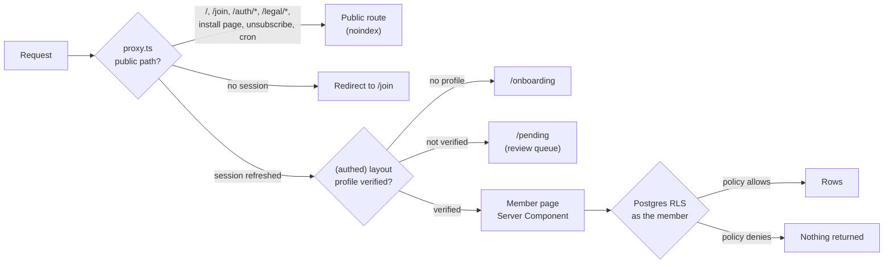
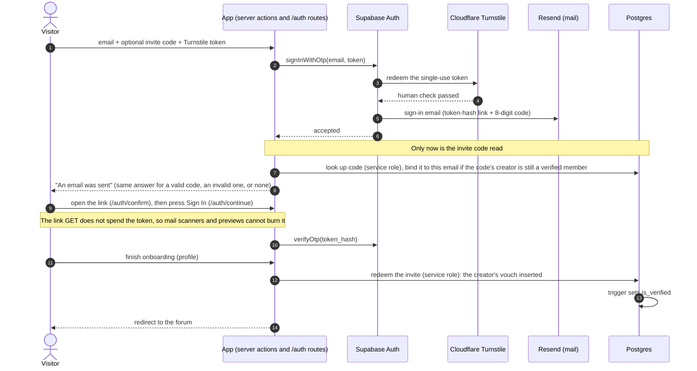
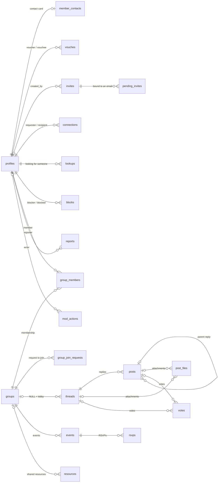
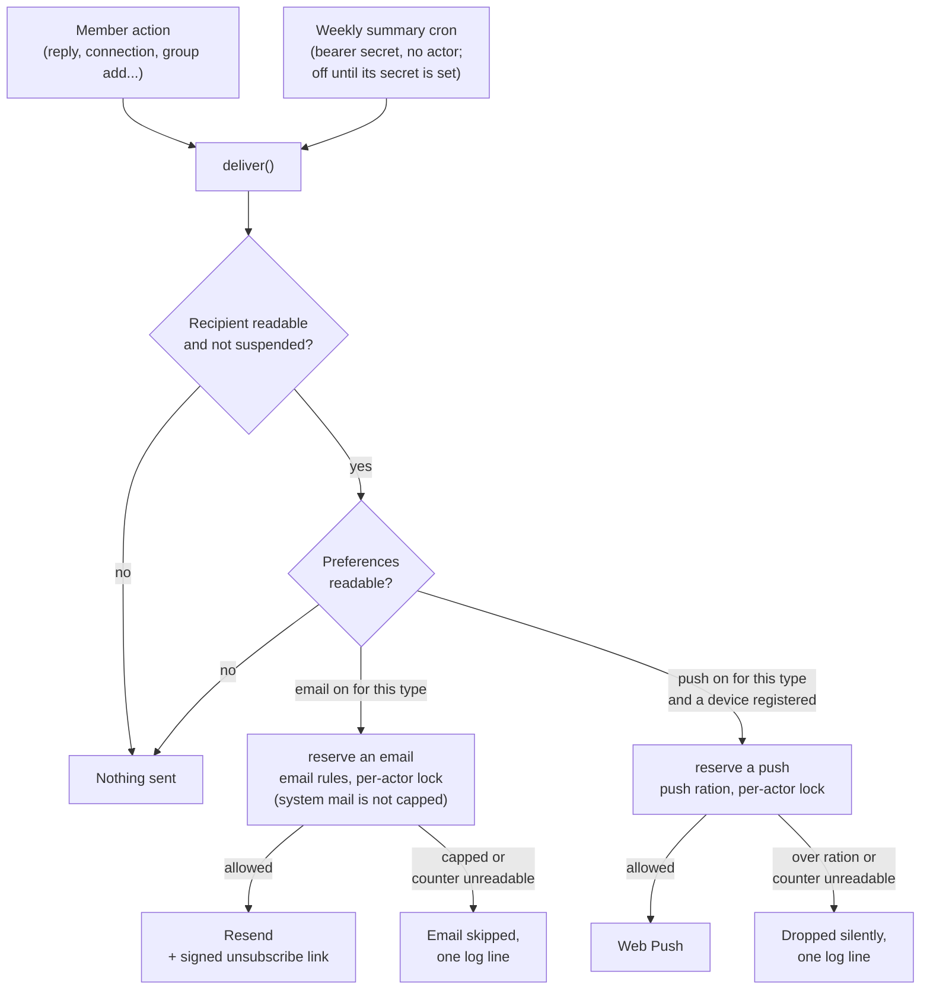
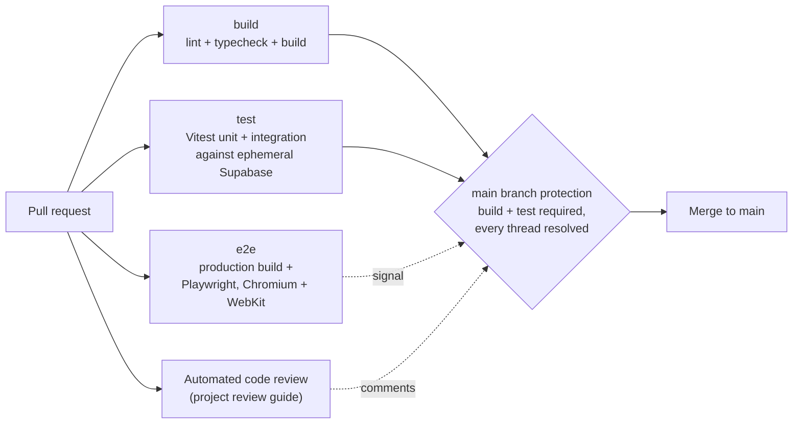

# Architecture: On the Lees

On the Lees is a members-only, real-name network for sommeliers and wine professionals. This page goes one level below the [README](../README.md). Table and route names are from the private repository; no member data appears here.

---

## 1. Three Gates on Every Member Request

Access to a member page is checked three times. The database check binds every read and write a member's session makes. Server code that has to act beyond one member's rights (invite lookups and redemption, the storage sweep, the send counters) runs as the service role or a `security definer` function, which RLS does not bind by design.

| Layer | What it decides |
|-------|-----------------|
| Proxy (`proxy.ts`, Next 16's name for middleware) | Refreshes the session cookie; a non-public route without a session goes to `/join` |
| `(authed)` layout | No profile goes to onboarding; an unverified profile goes to `/pending` |
| Row-level security | RLS is on for every table in the `public` schema; member-facing tables carry members-only policies for the `authenticated` role, and server-only tables carry none. `anon` holds no table privilege. Server code reads identity with `getUser()`, never `getSession()` |

**Not crawled, and marked noindex.** `robots.ts` disallows every crawler from every path, and every response also carries `noindex`, in the root metadata and in an `X-Robots-Tag` header that covers non-HTML responses.

---

## 2. Joining: From Stranger to Verified Member

There are no passwords. The order of operations is the security property: nothing about an invite is read until Supabase Auth has accepted the human check.

| Path | How a person gets verified |
|------|----------------------------|
| Invite code at the request door | A bound code is redeemed at the end of onboarding; the vouch trigger verifies them |
| No code | They wait on `/pending`; a moderator's approval is a vouch, so it verifies them the same way |
| A code obtained later | `/pending`, Apply Code: limited per account by the hour, counted in a server-only table before any code is read |

- **Members share codes; they do not mint them.** Only a moderator creates an invite, in the app or through the service role with the moderator recorded as its creator, and each has a use cap and an expiry.
- **A code binds only if its creator can still vouch.** A code with no creator, or one whose creator is no longer a verified member, is never bound, so its holder waits for a moderator like anyone without a code.
- **The app never calls Cloudflare's verification endpoint.** The token is single use, and verifying it in the app would spend it, so Auth would reject every real sign-in.

---

## 3. Data Model

Twenty-five tables, all in `public`, all with RLS enabled. The core relationships:

The other five hold notification settings, registered push devices, and three server-only tables that no client role holds a grant on: the Apply Code attempt counter, the notification send counter and the weekly-summary watermarks.

**One forum table for everything.** The lobby and every group's forum are the same `threads` table, scoped by `group_id` (NULL is the lobby), and every group-scoped read goes through one SQL helper. Private and hidden groups read identically and differ only in whether the group can be discovered.

---

## 4. Authorization in the Database

Four techniques close the gaps that policies alone leave open.

| Technique | Why it is needed |
|-----------|------------------|
| **Freeze triggers** on ownership and scope columns | An UPDATE policy authorizes the row, not the column. A `WITH CHECK` sees only the new row, so it cannot stop a row leaving its group |
| **`security definer` helpers** with explicit grants | Helpers avoid policy recursion; a policy is checked as the calling role, so its predicates keep a grant to `authenticated` |
| **A private schema** for predicates about another member | The block check and the contact-visibility check live where the API does not expose them, so they cannot be called as an oracle |
| **Server-only tables** (RLS on, no policy, no grant) | Counters and watermarks a member must never read or move |

**Contact privacy is enforced in the database.** The `member_contacts` base table is readable only by its owner. Everyone else reads through one function that nulls each field the caller may not see under its owner's setting: Any Member, Connections Only, or Hidden.

**Moderation leaves a record.** The moderator action log is append-only and no client can write it. Suspensions, restores, role changes, vouches, report resolutions, group deletions and moderator deletes of another member's content each write a row.

---

## 5. Photos and Files

| | Photos | Files |
|---|---|---|
| Accepted (private bucket) | PNG, JPEG, WebP, GIF, up to 10 MB | PDF, plain text, CSV, up to 25 MB |
| Stored as | Resized and re-encoded in the browser by the app's uploader, which drops EXIF metadata, GPS location included, before upload | Byte for byte, under a generated name |
| Limit | 4 per post, by a check constraint on the post's photo list | 4 per post, by a trigger under an advisory lock |
| Opened by | A URL signed for an hour when the page renders | `/files/<id>`, which checks access and answers `303` to a URL signed for 60 seconds, always as a download |

- **Reads follow the post.** A signed URL for a photo or file is issued only to someone who can read its thread, with no exception for moderators.
- **Deletes clean up after themselves.** A sweep runs as the service role, only after RLS allowed the delete and only inside the post author's folder, so a forged reference to another member's photo is never removed.

---

## 6. Notifications

Notifications go through one function, `deliver()`, because a second place to send is how a rule goes missing from one of the eight email templates. Seven of the eight go through it; the exception is the access-approved email, sent once when a person is let in: it is transactional, like the sign-in email, so there is no preference or unsubscribe to apply. Sign-in mail is Supabase Auth's own and never passes through the app.

- **Email is limited per member**, by the hour and by the day, so one member's flood never silences everyone else.
- **One sender to one recipient** about the same type and subject is spaced out by minutes and capped by the day, which stops a repeated action from mailing the same person again and again without taking the second reply of an afternoon.
- **Push has its own, wider limits** that ignore the subject, because making a group is free and a window keyed on the group is one new group away from no window at all.
- **A bulk add is capped at the hour's allowance**, since each add mails the member added.

- **Decided and recorded in one statement.** The reservation is one `security definer` function under a per-actor advisory lock, so one member's sends queue behind each other and nobody else waits. A counter that cannot be read skips the email; the member's action still succeeds.
- **The weekly summary**, built but not yet switched on in production, claims each member's watermark row before their message goes out, so two overlapping runs cannot both mail the same member.

---

## 7. Privacy in Monitoring and Caching

- **Sentry, errors first.** No session replay, `sendDefaultPii: false`, light sampled tracing, and a scrubber that drops the console argument echo and keeps only the first line of each exception message, because a database error can carry a member's email or phone in its details.
- **No service-worker cache.** The service worker has no fetch handler, so it never stores a member page; phones get shared.

---

## 8. Testing and CI

- **Integration tests check RLS.** They sign in as different members against a local Supabase to check that a non-member cannot read anything newly gated. A structural test in the required `test` job fails if any public table lacks RLS or `anon` is granted a table privilege.
- **End-to-end tests run against a production build**, on desktop Chromium, with twelve phone-critical surfaces run again on iPhone WebKit. Specs sign in through the real door with the one-time token the email carries.
- **A tap-target guard** on iPhone WebKit measures the controls on the main pages, apart from a short commented list of exemptions, and fails the end-to-end job when one drops under 44 by 44 pixels. It was added after a measurement found nearly half the controls under the rule.
- **The project's Definition of Done** for a pull request also lists unit tests for new logic, an RLS test for anything newly gated, an end-to-end happy path, screenshots at 1280 and 390 pixels reviewed by eye, and the copy lint. Branch protection requires the build and test checks and resolved review threads; end-to-end runs for signal.

---

## 9. Operations

- **Deploys are manual** from the Vercel CLI. Rollback is promoting the previous production deployment.
- **A short weekly checklist** works alongside Sentry's error reports: stuck sign-ups, the review queue, server errors, mail sending and backups, among other items.
- **Test walks on production use a throwaway member inside a private group**, never the owner's account and never a place members can see. The one recorded exception is the owner's smoke test before the network was first shared.
